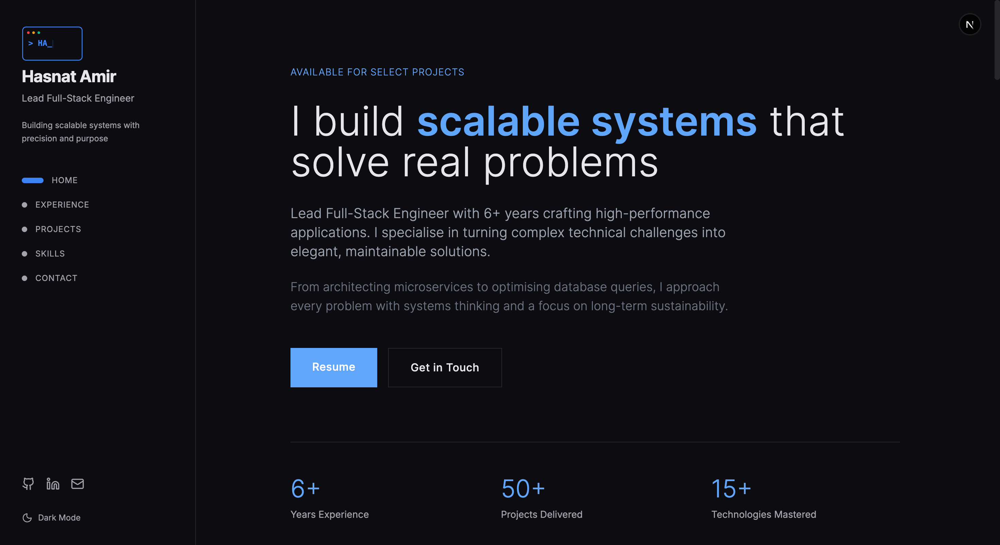

# Devfolio

👨🏻‍💻 All the things I wish to share with you are here, Built on `NextJS`, `Typescript`, `TailwindCss` and `ReactJS`

### ✨ [Live Demo](https://www.hasnatdev.com/)



## Getting Started

In the project directory, you can run:

### `yarn`
### `yarn dev`

Runs the app in the development mode.\
Open [`http://localhost:3000`](http://localhost:3000) to view it in the browser.

## Contact form verification

The contact form uses the existing Cloudflare Turnstile widget
`0x4AAAAAAFwWCJoPniH2HJz_` with the `contact` action. `/api/send` validates
every token with Cloudflare before sending either email. Tokens must be valid,
unused, and issued for an explicitly allowed frontend hostname and action.

Set these server-only variables in the ignored `.env.local` file for local
development and in the deployment's environment settings:

```dotenv
TURNSTILE_SECRET=<existing widget secret>
TURNSTILE_HOSTNAMES=localhost,127.0.0.1
```

For production, set `TURNSTILE_HOSTNAMES=hasnatdev.com`. Never include local
hostnames in the production value. Preview deployments need their own exact
frontend hostname in this variable and an allowed domain on the widget.
Keep `TURNSTILE_SECRET` private; do not prefix it with `NEXT_PUBLIC_` or commit it.
The backend rejects submissions when verification or its configuration fails.
The widget resets after every submission attempt to obtain a new token.

Run `node --test tests/turnstile.test.cjs` to check the backend verification gate
with mocked Cloudflare and email responses. These checks do not prove live email
delivery or production verification. Before release, submit a fresh real token
through the contact form and confirm that replaying it is rejected.

## Contact email through Gmail

After Turnstile verification, `/api/send` uses Gmail SMTP to send an inquiry to
`hasnatamir2@gmail.com` and a separate confirmation to the visitor. Both messages
come from that Gmail account. Replies to the inquiry go to the visitor; replies
to the confirmation go to Hasnat. A confirmation failure is reported in the
form without asking the visitor to resubmit an inquiry already received.

Enable 2-Step Verification on `hasnatamir2@gmail.com`, then create a dedicated
[Google app password](https://myaccount.google.com/apppasswords) named
`Hasnatdev contact form`. Save it in the ignored `.env.local` file:

```dotenv
GMAIL_APP_PASSWORD=<Google app password>
```

Use the app password, not the normal Google account password. Configure the same
server-only variable in Vercel production before deploying. Never commit it,
prefix it with `NEXT_PUBLIC_`, or paste it into chat. Google Cloud projects,
OAuth clients, and OAuth publishing are not needed for this integration.

Messages use TLS on `smtp.gmail.com:465`. Both sends are awaited before the API
responds. Spaces in the displayed app password are removed automatically.
[Personal Gmail sending limits](https://support.google.com/mail/answer/22839)
also apply. The API accepting a message does not prove inbox delivery.
This integration does not automatically retry ambiguous email sends.

Run `node --test tests/*.test.cjs` for the backend verification and Gmail tests.
They mock SMTP sending; verify real delivery after account setup.

## Design

You can always draw inspiration from the design, and no, you don't have to give me credits for that. Devfolio is designed by Ali Raza, a rising talent in UI/UX design [Ali Rza](https://www.linkedin.com/in/alirzahere). Check it out and show him so love ❤️.
